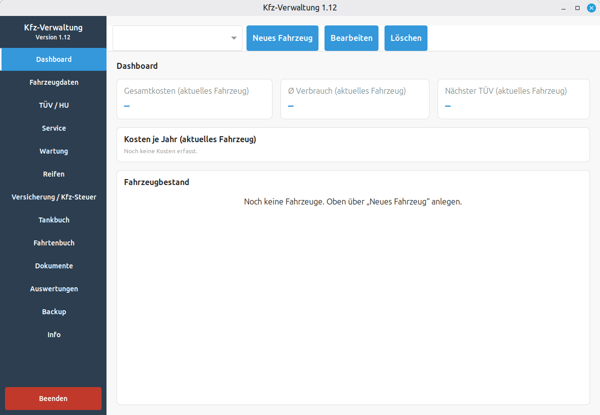

# Kfz-Verwaltung

Komplette Kfz-Verwaltung für Linux Mint 22.x (GTK 3) – das gesamte Programm in **einer einzigen Python-Datei**: `Kfz-Verwaltung-1.13.py` (Version 1.13).

Die Änderungshistorie der letzten Versionen findet sich im [Changelog](CHANGELOG.md).

## Über das Projekt

Die Kfz-Verwaltung ist eine Desktop-Anwendung zur Verwaltung eines oder mehrerer Fahrzeuge. Alle Daten liegen als JSON-Dateien lokal auf dem eigenen Rechner (`~/.kfz-verwaltung/`) – es gibt keine Cloud, keine Anmeldung und keine Übertragung persönlicher Daten.

## Abbildung



## Module im Überblick

| Modul | Inhalt |
| --- | --- |
| **Dashboard** | Kennzahlen (Gesamtkosten, Ø Verbrauch, nächste HU), Kosten je Jahr und der komplette Fahrzeugbestand (Name und Kennzeichen) |
| **Fahrzeugdaten** | Stammdaten (Hersteller, Modell, Kennzeichen, VIN, Erstzulassung …) und Technikdaten (Hubraum, Gewichte, Reifengrößen, Reifendrücke …) |
| **Hauptuntersuchung** | Datum und Ergebnis von Hauptuntersuchungen, nächster Termin und ausführliche Notizen (großes Textfeld) – der nächste Termin erscheint automatisch im Dashboard |
| **Service** | durchgeführte Arbeiten mit Datum, km-Stand, Kosten, Werkstatt und einem großen Textfeld für die Beschreibung |
| **Wartung** | Wartungs-Check mit Datum, km-Stand, Kühlflüssigkeit, Ölständen (Motor/Getriebe/Servopumpe), Batteriespannung und Luftdruck (VL/HL/VR/HR) sowie Bemerkungen |
| **Reifen** | Reifensätze mit Sommer-/Winterkennzeichnung, Kosten und Wechsel-Notizen |
| **Versicherung / Kfz-Steuer** | Versicherer, Versicherungsnummer, Beitrittsdatum (Versicherungsjahr), Beitrag, Zahlungsintervall und Kfz-Steuer |
| **Tankbuch** | Betankungen mit Datum, km-Stand, Menge, Kosten, Tankstelle; berechnete Spalten Ø l/100km (2 Nachkommastellen), gefahrene km und Ø €/Liter – die Spalte „Tankstelle“ steht am Ende |
| **Fahrtenbuch** | Fahrten mit Datum, Anlass, Tacho-Stand „von“ und „bis“ sowie großer Fahrtstrecken-Beschreibung; gefahrene km bzw. Milen werden aus der Differenz berechnet |
| **Dokumente** | Ablage von Dokumentpfaden mit Kategorien; Klick auf den Pfad öffnet das Verzeichnis im Dateimanager |
| **Auswertungen** | Kosten-Aufschlüsselung je Fahrzeug, Jahres-Tabelle „Kosten je Jahr“ (inkl. Ø Verbrauch und gefahrene km), Tankbuch-Statistik wahlweise für „Alle Jahre“ oder ein einzelnes Kalenderjahr, Meilen-Faktor und Hochrechnung des Verbrauchs auf eine einstellbare Distanz |

## Bedienung

- **Fahrzeuge**: oben in der Kopfzeile über das Ausklappfenster wählen oder neu anlegen; das ausgewählte Fahrzeug gilt für alle Module
- **Einträge erfassen / bearbeiten**: Schaltflächen „Neuer Eintrag“, „Bearbeiten“ (oder Doppelklick auf die Tabellenzeile) und „Löschen“
- **Tabellen**: alle Spalten durch Klick auf die Überschrift sortierbar (Datenspalte chronologisch), Spaltenbreiten verstellbar, mehrzeilige Textspalten erhalten den restlichen Platz
- **Fenstergröße** und Maximierung werden dauerhaft gemerkt und beim nächsten Start wiederhergestellt

## Meilen-Tacho (km/Milen)

Für Fahrzeuge mit Meilen-Tacho:

1. Im Dialog die Option **„Angabe in Milen (wird automatisch in km umgerechnet)“** aktivieren – der Tacho-Stand wird beim Speichern mit dem Faktor in km umgerechnet (Tankbuch), im Fahrtenbuch entsprechend die gefahrene Distanz.
2. In den **Auswertungen** den Faktor **„1 Mile = X km“** (z. B. 1,37) pro Fahrzeug eintragen – daraus ergeben sich die Anzeigen „Ø Verbrauch l/100 Milen“ und „l/100 km“.

Gespeichert wird intern immer in km; die Milen-Werte sind Anzeige-/Berechnungswerte.

## Installation & Start

Voraussetzungen: Linux Mint 22.x (oder andere Debian-basierte Distributionen) mit Python 3 und GTK 3.

```bash
sudo apt install python3 python3-gi gir1.2-gtk-3.0
chmod +x Kfz-Verwaltung-1.13.py
./Kfz-Verwaltung-1.13.py
```

oder alternativ: `python3 Kfz-Verwaltung-1.13.py`

## Daten, Backup & Export

- Daten liegen unter `~/.kfz-verwaltung/` (eine JSON-Datei je Fahrzeug)
- **Backup**: frei wählbarer Zielordner, automatisch benannte ZIP-Archive, maximal 10 Backups werden vorgehalten
- **Export/Import**: vollständiger Datenexport als ZIP und Wiedereinlesen zum Umziehen oder Übertragen auf einen anderen Rechner

## Versionierung

Der Dateiname trägt die Version (`Kfz-Verwaltung-<Version>.py`), z. B. `Kfz-Verwaltung-1.13.py` für Version 1.13. Jede Ausbaustufe liegt als eigene, vollständig lauffähige Datei vor.

## Haftungshinweis

Die Anwendung dient der privaten Verwaltung von Fahrzeugdaten. Es wird keine Gewähr für die Vollständigkeit oder Richtigkeit der berechneten Werte übernommen.

## License

Dieses Projekt ist unter der **GNU General Public License Version 3.0 oder einer späteren Version (GPL-3.0-or-later)** lizenziert.

Du darfst diese Software gemäß den Bedingungen der Lizenz frei verwenden, untersuchen, verändern und weiterverbreiten. Wenn du diese Software oder veränderte Versionen davon weiterverbreitest, musst du die Bedingungen der Lizenz **GPL-3.0-or-later** einhalten. Dazu gehört auch, den entsprechenden Quellcode zugänglich zu machen.

Den vollständigen Lizenztext findest du in der Datei LICENSE.md.

Copyright (c) 2026 - 5oreh
